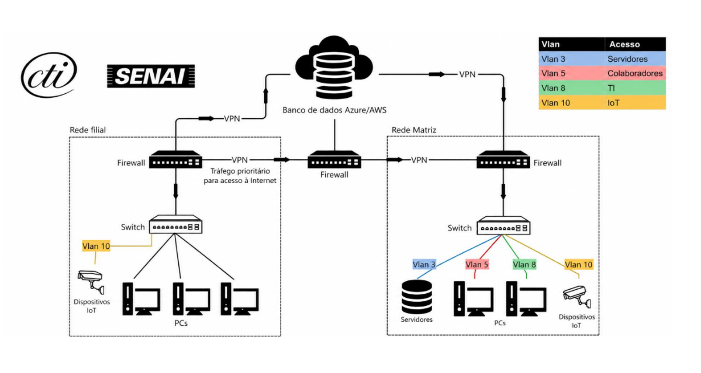

# NeoxGate — Projeto de Redes de Dados

## Sobre o projeto

A **NeoxGate** é um projeto acadêmico desenvolvido na Tutoria 2026, por alunos do SENAI em parceria com a CTI, com foco em infraestrutura de redes, segurança e conectividade.

O projeto propõe uma arquitetura de rede corporativa composta por uma matriz, uma filial e recursos em nuvem, considerando aspectos como segmentação de rede, configuração de firewall, comunicação entre ambientes e segurança da infraestrutura.

## Objetivos

- Desenvolver uma proposta de infraestrutura de rede corporativa.
- Aplicar conceitos de redes de computadores e segurança da informação.
- Planejar a segmentação da rede por VLANs.
- Trabalhar com firewalls e políticas de segurança.
- Estudar a conectividade entre matriz, filial e ambiente em nuvem.
- Documentar a arquitetura e as etapas de desenvolvimento do projeto.

## Arquitetura do projeto

A arquitetura proposta contempla os seguintes ambientes:

- **Matriz:** ambiente principal da infraestrutura de rede.
- **Filial:** ambiente conectado à matriz.
- **Nuvem:** recursos e conectividade em ambiente cloud.
- **Dispositivos de rede:** equipamentos envolvidos na comunicação e na segurança.
- **Dispositivos IoT:** equipamentos considerados na arquitetura do projeto.

### Diagrama da arquitetura

O diagrama apresenta a arquitetura geral proposta para o projeto.

### Protótipo da matriz

A imagem apresenta o protótipo desenvolvido para o ambiente da matriz.

## Tecnologias e conceitos

O projeto envolve estudos e aplicações relacionados a:

- Redes de computadores
- VLANs e segmentação de rede
- Firewalls e políticas de segurança
- VPN e conectividade entre ambientes
- Computação em nuvem (AWS e Azure)
- Infraestrutura de TI
- Dispositivos IoT
- Documentação técnica de redes

## Segmentação de rede

A segmentação por VLANs faz parte da proposta de organização da infraestrutura, permitindo separar os ambientes e os tipos de dispositivos conforme suas funções e necessidades de comunicação.

O planejamento considera diferentes grupos de dispositivos, incluindo servidores, equipe de TI e dispositivos IoT.

A comunicação entre os segmentos deve respeitar as políticas de segurança definidas para a arquitetura.

## Minha participação — Firewall da matriz

Minha participação no projeto está concentrada na **configuração do firewall da matriz**, aplicando conhecimentos de redes de computadores e segurança da informação.

Essa atividade envolve o trabalho com a configuração do equipamento e os aspectos de segurança e controle de tráfego correspondentes ao ambiente principal, conforme as necessidades definidas para o projeto.

O desenvolvimento é realizado em conjunto com a equipe, integrando essa parte à arquitetura geral da NeoxGate.

## Status do projeto

**Em desenvolvimento.**

O projeto está em fase de construção, documentação e validação da solução proposta.

As atividades seguem o planejamento da equipe e os requisitos definidos em parceria com a CTI.

## Equipe

Projeto desenvolvido em equipe por alunos do SENAI, em parceria com a CTI, no contexto da Tutoria 2026.

## Segurança e divulgação

Este repositório tem finalidade acadêmica e de documentação do projeto.

Informações confidenciais, credenciais, senhas, chaves de acesso e configurações sensíveis não devem ser publicadas.

A divulgação de documentos, imagens e informações relacionadas à empresa deve respeitar as autorizações e orientações recebidas.

---

**NeoxGate — Projeto de Redes de Dados | Tutoria 2026**
